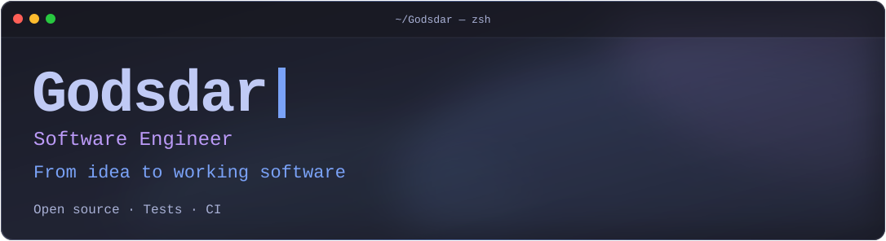

<picture>
  <source media="(max-width: 600px)" srcset="./assets/header-mobile.svg">
  
</picture>

Hi, I'm Ildar, a junior fullstack developer in Almaty. I build with **Node.js / Express, TypeScript and React / Next.js**, with a little more focus on frontend. I also work with Vue 3 and Laravel.

I like Linux, Arch and Neovim, and tools that feel fast. Word histories, chess and browser graphics are some of the things I enjoy exploring through code.

**Open to remote full-time work and project contracts.** UTC+5. [ildar.popov.dev@gmail.com](mailto:ildar.popov.dev@gmail.com) · [hh](https://almaty.hh.kz/resume/4a5654ceff107d051d0039ed1f356454725545) · [Upwork](https://www.upwork.com/freelancers/~01fec55e21f1f0fc51)

## Selected projects

### [CineShelf](https://github.com/Godsdar/CineShelf)

Movie search, sign-in and a personal watchlist. Next.js, PostgreSQL and Auth.js, with Vitest tests and CI.

[Live demo](https://cine-shelf-lemon.vercel.app) · [Source](https://github.com/Godsdar/CineShelf) · [CI](https://github.com/Godsdar/CineShelf/actions/workflows/ci.yml)

### [Lingua](https://github.com/Godsdar/lingua)

Explore word histories across languages. One TypeScript core shared by a web app, a Chrome extension and an Electron desktop app.

[Live demo](https://godsdar.github.io/lingua/) · [Source](https://github.com/Godsdar/lingua)

Chess, graphics and a few more projects

### [chess-engine](https://github.com/Godsdar/chess-engine)

A chess board that plays back. TypeScript, React, minimax and alpha-beta pruning.

[Play](https://godsdar.github.io/chess-engine/) · [Source](https://github.com/Godsdar/chess-engine)

### [Tesseract](https://github.com/Godsdar/Tesseract)

An interactive 4D hypercube wireframe in the browser, built with three.js.

[Explore](https://godsdar.github.io/Tesseract/) · [Source](https://github.com/Godsdar/Tesseract)

- [astro-local-landing](https://github.com/Godsdar/astro-local-landing): an Astro and TypeScript landing starter with Vitest tests, CI and a [live demo](https://godsdar.github.io/astro-local-landing/).
- [Serenity](https://github.com/Godsdar/Serenity): a Laravel 12 and React blog.
- [React + Laravel blog](https://github.com/Godsdar/Simple-blog-React-Laravel-REST-API-).

## Open source

Merged:

- [mergepay-web #413](https://github.com/mergepay/mergepay-web/pull/413): a Vitest suite for the expense-split logic.
- [mergepay-web #449](https://github.com/mergepay/mergepay-web/pull/449): error boundaries and fallback states for wallet and API transactions, with tests.
- [kana-dojo #29635](https://github.com/lingdojo/kana-dojo/pull/29635): fixed a broken JSON file that stopped the idioms from loading.
- [kana-dojo #29509](https://github.com/lingdojo/kana-dojo/pull/29509) and [#29507](https://github.com/lingdojo/kana-dojo/pull/29507): a Japanese proverb and a theme.

Still open:

- [excalidraw #12026](https://github.com/excalidraw/excalidraw/pull/12026): Ctrl/Cmd+S should still save while CapsLock is on.

A little about how I work

I also build internal business tools: Telegram analytics, timesheet and back-office tooling. Those repositories stay private.

I use coding agents to draft implementations. I choose the scope and structure, read the diff and run the project checks before committing.

Russian native · English B2 · conversational Spanish
