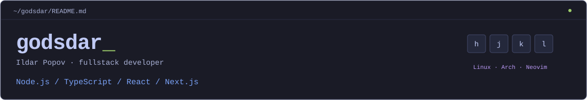

  

<samp>TypeScript / Node.js / React · Almaty, UTC+5</samp>

  <a href="#upstream">upstream</a> &nbsp;·&nbsp;
  <a href="#things-i-build">projects</a> &nbsp;·&nbsp;
  <a href="#say-hello">contact</a>

I build full-stack web apps with **TypeScript, Node.js / Express and React / Next.js**. Frontend is my strongest focus; I also work with Vue 3 and Laravel.

My favourite corners of the web: browser internals, word histories, and graphics you can play with. That is how an etymology explorer, a chess engine and a 4D hypercube ended up next to a movie app here.

## Upstream

**Merged patches**

- [mergepay-web #413](https://github.com/mergepay/mergepay-web/pull/413): a Vitest suite for the expense-split logic.
- [mergepay-web #449](https://github.com/mergepay/mergepay-web/pull/449): error boundaries and fallback states for wallet and API transactions, with tests.
- [kana-dojo #29635](https://github.com/lingdojo/kana-dojo/pull/29635): fixed a broken JSON file that stopped the idioms from loading.
- [kana-dojo #29509](https://github.com/lingdojo/kana-dojo/pull/29509) and [#29507](https://github.com/lingdojo/kana-dojo/pull/29507): a Japanese proverb and a theme.

**In review**

- [excalidraw #12026](https://github.com/excalidraw/excalidraw/pull/12026): Ctrl/Cmd+S should still save while CapsLock is on.

## Things I build

| Preview | Project | Links |
| --- | --- | --- |
|  | **CineShelf** A movie search app with real posters, a personal watchlist and sign-in. Next.js 16, PostgreSQL and Auth.js, with Vitest tests and CI. | [demo](https://cine-shelf-lemon.vercel.app) · [code](https://github.com/Godsdar/CineShelf) |
|  | **Lingua** An etymology explorer that shares one core across a web app, a Chrome extension and an Electron desktop app. | [demo](https://godsdar.github.io/lingua/) · [code](https://github.com/Godsdar/lingua) |
|  | **chess-engine** A chess board that plays back, with a minimax and alpha-beta engine in TypeScript. | [demo](https://godsdar.github.io/chess-engine/) · [code](https://github.com/Godsdar/chess-engine) |
|  | **Tesseract** A 4D hypercube rendered in the browser with three.js. | [demo](https://godsdar.github.io/Tesseract/) · [code](https://github.com/Godsdar/Tesseract) |

Also on GitHub: **[Serenity](https://github.com/Godsdar/Serenity)** (a Laravel 12 and React blog), a **[React + Laravel blog](https://github.com/Godsdar/Simple-blog-React-Laravel-REST-API-)**, and **[astro-local-landing](https://godsdar.github.io/astro-local-landing/)** (an Astro and TypeScript landing starter with Vitest tests, CI and a live demo; [code](https://github.com/Godsdar/astro-local-landing)).

I also build internal business tools for a client (Telegram analytics, timesheet and back-office tooling). Those stay private.

Behind the commits

I use coding agents to draft implementations. I choose the scope and structure, review the diff and run the project checks before committing.

## Say hello

Open to **remote full-time work and project contracts**. English B2, Russian native, conversational Spanish.

[ildar.popov.dev@gmail.com](mailto:ildar.popov.dev@gmail.com) · [Upwork](https://www.upwork.com/freelancers/~01fec55e21f1f0fc51) · [hh](https://almaty.hh.kz/resume/4a5654ceff107d051d0039ed1f356454725545)
