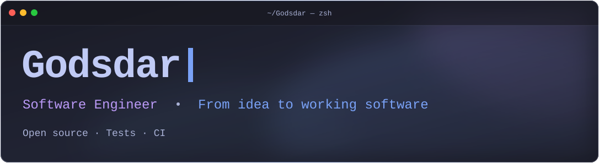
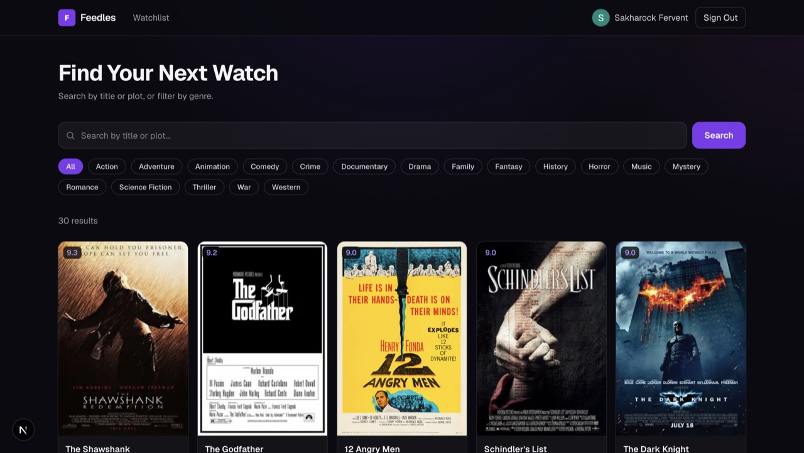
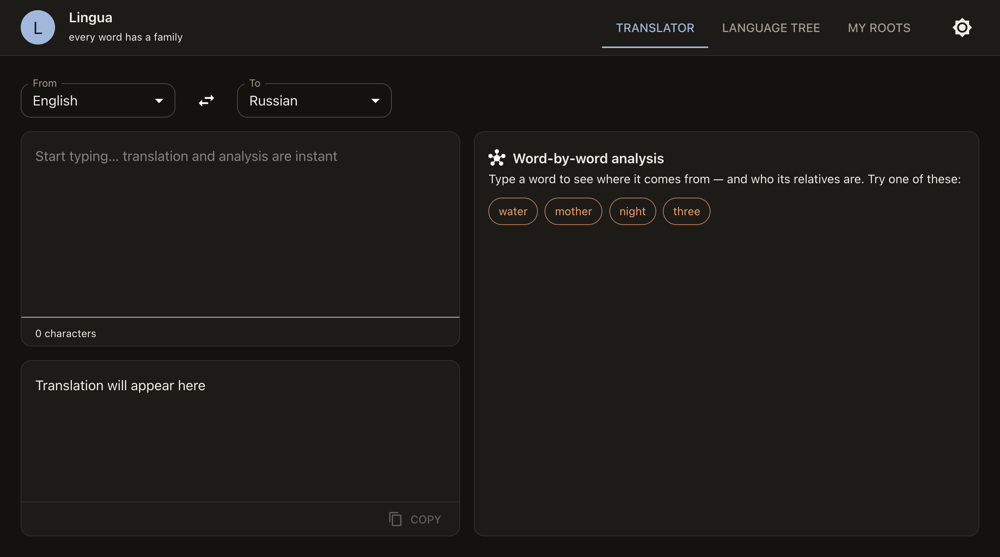
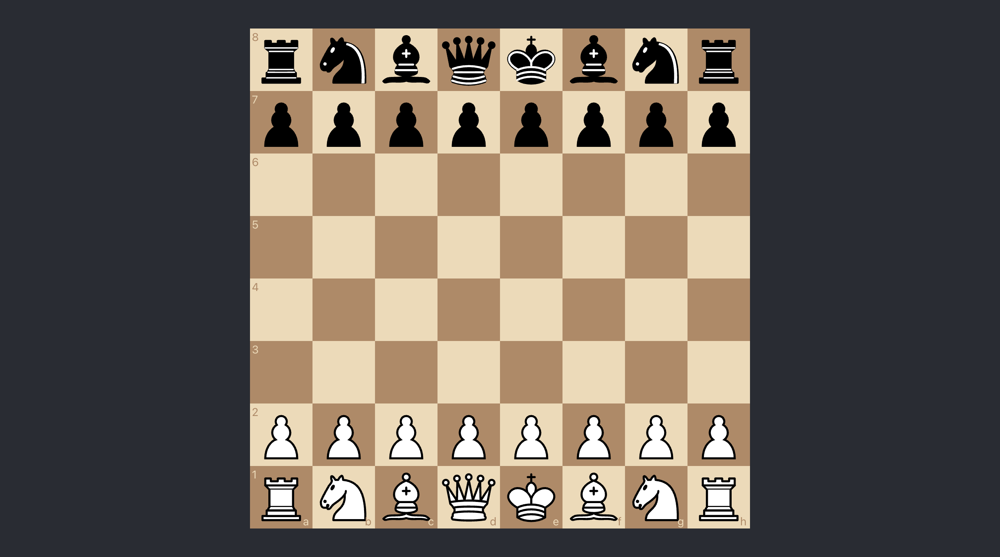
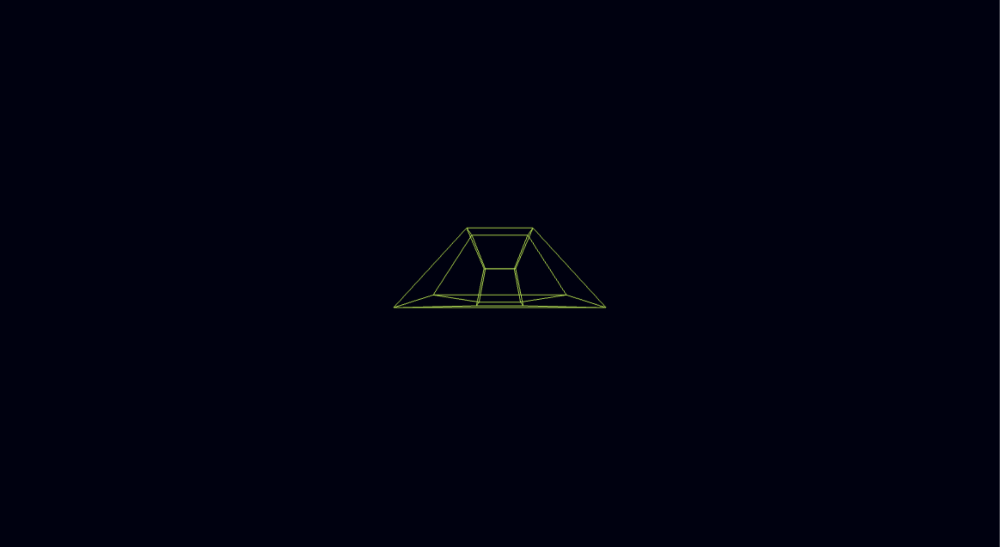

<picture>
  <source media="(max-width: 600px)" srcset="./assets/header-mobile-e4a2b78258.svg">
  
</picture>

I'm Ildar, a Software Engineer experienced with **Node.js / Express, TypeScript and React / Next.js**. I build full-stack apps and internal business tools, with a strong focus on frontend.

My work includes client tools for Telegram analytics, timesheets and back-office workflows, and merged tests and fixes in MergePay. I also enjoy exploring word histories, chess engines and browser graphics.

**Open to remote full-time work and project contracts.** Almaty, UTC+5.

[ildar.popov.dev@gmail.com](mailto:ildar.popov.dev@gmail.com) · [hh](https://almaty.hh.kz/resume/4a5654ceff107d051d0039ed1f356454725545) · [Upwork](https://www.upwork.com/freelancers/~01fec55e21f1f0fc51)

## Selected projects

<table>
<tr>
<td width="50%" valign="top">
<h3><a href="https://github.com/Godsdar/CineShelf">CineShelf</a></h3>

Movie search, sign-in and a personal watchlist. Next.js · PostgreSQL · Auth.js · Vitest &amp; CI

<a href="https://cine-shelf-lemon.vercel.app">Try it</a> · <a href="https://github.com/Godsdar/CineShelf">Code</a>

</td>
<td width="50%" valign="top">
<h3><a href="https://github.com/Godsdar/lingua">Lingua</a></h3>

Explore word histories across languages. One TypeScript core for web, Chrome &amp; Electron

<a href="https://godsdar.github.io/lingua/">Try it</a> · <a href="https://github.com/Godsdar/lingua">Code</a>

</td>
</tr>
<tr>
<td width="50%" valign="top">
<h3><a href="https://github.com/Godsdar/chess-engine">chess-engine</a></h3>

A chess board that plays back. TypeScript · React · minimax + alpha-beta

<a href="https://godsdar.github.io/chess-engine/">Play</a> · <a href="https://github.com/Godsdar/chess-engine">Code</a>

</td>
<td width="50%" valign="top">
<h3><a href="https://github.com/Godsdar/Tesseract">Tesseract</a></h3>

A little window into four dimensions. Interactive 4D wireframe · three.js

<a href="https://godsdar.github.io/Tesseract/">Explore</a> · <a href="https://github.com/Godsdar/Tesseract">Code</a>

</td>
</tr>
</table>

A few more projects

- [astro-local-landing](https://github.com/Godsdar/astro-local-landing): Astro and TypeScript, Vitest, CI and a [live demo](https://godsdar.github.io/astro-local-landing/).
- [Serenity](https://github.com/Godsdar/Serenity): a Laravel 12 and React blog.
- [React + Laravel blog](https://github.com/Godsdar/Simple-blog-React-Laravel-REST-API-).

## Open source

Merged:

- [mergepay-web #413](https://github.com/mergepay/mergepay-web/pull/413): a Vitest suite for the expense-split logic.
- [mergepay-web #449](https://github.com/mergepay/mergepay-web/pull/449): error boundaries and fallback states for wallet and API transactions, with tests.
- [kana-dojo #29635](https://github.com/lingdojo/kana-dojo/pull/29635): fixed a broken JSON file that stopped the idioms from loading.
- [kana-dojo #29509](https://github.com/lingdojo/kana-dojo/pull/29509) and [#29507](https://github.com/lingdojo/kana-dojo/pull/29507): a Japanese proverb and a theme.

Still open:

- [excalidraw #12026](https://github.com/excalidraw/excalidraw/pull/12026): Ctrl/Cmd+S should still save while CapsLock is on.

A little about how I work

I also work with Vue 3 and Laravel. The client repositories stay private.

I use coding agents to draft implementations. I choose the scope and structure, read the diff and run the project checks before committing.

Russian native · English B2 · conversational Spanish
